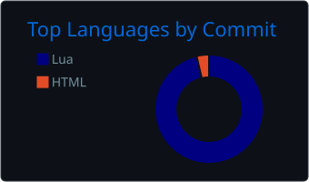

# <a href="https://discordapp.com/users/500441130303881247" style="color: #FFD700;">GLDNRMZ</a> 

  

---

## 📊 GitHub Stats

  
  

---

## 🌐 Links

  
  
  
  

---

## 🎯 Focus Areas
- 🔧 Custom FiveM systems & gameplay mechanics  
- 🧩 QBCore / QBox framework development  
- 🔌 ox_lib and ox_inventory integrations  
- ⚙️ Configurable, maintainable architecture  
- 🚀 Server-side performance optimization  

---

## 🛠 Technologies
- 💻 Lua  
- 🌐 JavaScript  
- 🗄 SQL  
- 🎮 FiveM  
- 🔲 QBCore / QBox  
- 🧰 ox_lib  
- 📦 ox_inventory  
- 🛠 MySQL / MariaDB  
- 🧑‍💻 Git

---

  

